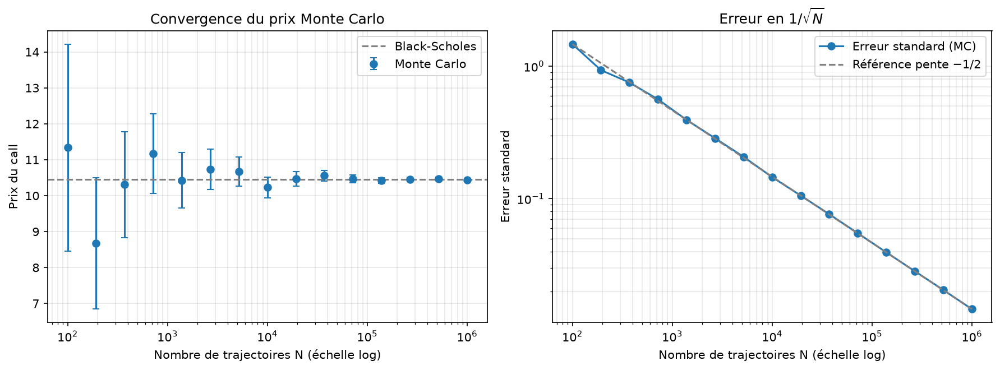

# Structured Products Pricing

Pricing et hedging de produits structurés en Python.

Le projet suit le travail d'un structureur : **pricer** un produit, le **couvrir** (delta-hedging) et **mesurer le P&L** de la couverture. Tout le code est écrit et testé de façon à pouvoir être expliqué ligne par ligne.

## Ce qui est fait (phase 1)

- **Black-Scholes** avec dividende continu : prix du call et du put.
- **Greeks analytiques** : delta, gamma, vega, rho, theta (call et put).
- **Monte Carlo européen** : prix, erreur standard et intervalle de confiance à 95 %, validé contre la formule fermée.
- **Notebook** : courbes des Greeks, effet de la maturité sur le gamma, convergence du Monte Carlo.



## Structure du dépôt

```
Structured-Products-Pricing/
├── src/
│   ├── black_scholes.py     prix et Greeks
│   └── monte_carlo.py       pricer Monte Carlo européen
├── tests/                   tests pytest
├── notebooks/               exploration et résultats (importent src/)
├── docs/                    figures du README
├── pyproject.toml           configuration de pytest
└── README.md
```

La logique est dans `src/`. Les notebooks ne contiennent que des appels et des graphiques.

## Installation

```bash
git clone https://github.com/DamienLedoux/Structured-Products-Pricing.git
cd Structured-Products-Pricing
conda create -n structu python=3.11
conda activate structu
conda install numpy scipy pandas matplotlib pytest jupyter
```

Lancer les tests (depuis la racine du projet) :

```bash
pytest -v
```

## Exemple d'utilisation

```python
import black_scholes as bs
import monte_carlo as mc

# Cas de référence : S = K = 100, T = 1, r = 5 %, sigma = 20 %, q = 0
bs.bs_call(100, 100, 1.0, 0.05, 0.20)     # 10.4506
bs.bs_delta_call(100, 100, 1.0, 0.05, 0.20)

# Monte Carlo : prix, erreur standard, intervalle de confiance à 95 %
price, se, (low, high) = mc.mc_european(
    100, 100, 1.0, 0.05, 0.20, option_type="call", n_paths=1_000_000, seed=42
)
```

Conventions : `T` en années, `r` et `q` annualisés, vega pour une variation de volatilité de 1,00 et theta par an.

## Validation

Les tests sont conçus pour être **indépendants** du code qu'ils vérifient :

- le put est codé avec N(−d₂) et N(−d₁), puis vérifié par la **parité call-put** ;
- chaque Greek est comparé à une **dérivée numérique** (différences finies centrées) du prix ;
- les relations entre call et put (par exemple delta call − delta put = e^(−qT)) sont testées séparément ;
- le Monte Carlo doit retrouver Black-Scholes à moins de 3 erreurs standard, sur des jeux de paramètres variés (ATM, ITM, OTM, maturités courtes et longues, q nul et non nul) ;
- l'erreur standard doit décroître en 1/√N, et les résultats sont reproductibles à seed fixé.

Chaque test a été vérifié en **cassant volontairement le code** pour s'assurer qu'il échoue.

## Feuille de route

| Phase | Contenu | Statut |
|---|---|---|
| 1. Fondations | Black-Scholes, Greeks, Monte Carlo européen | Fait |
| 2. Hedging | Simulateur de delta-hedging : P&L, rebalancement discret, coûts de transaction, volatilité mal estimée | À faire |
| 3. Produit structuré | Reverse convertible puis autocall simplifié en Monte Carlo | À faire |
| 4. Réalisme | Surface de volatilité (données réelles), SVI, volatilité locale | Bonus |
| 5. Finition | Notebooks de résultats, documentation | En continu |

## Limites du modèle

- **Volatilité constante** : le modèle de Black-Scholes ignore le smile de volatilité observé sur le marché.
- **Options européennes uniquement** pour l'instant, avec un dividende continu.
- **Pas de coûts de transaction ni de frictions** à ce stade.
- **Monte Carlo sans réduction de variance** (les variables antithétiques ne sont pas encore implémentées).
- Aucune donnée de marché réelle n'est utilisée.

## Auteur

Damien Ledoux